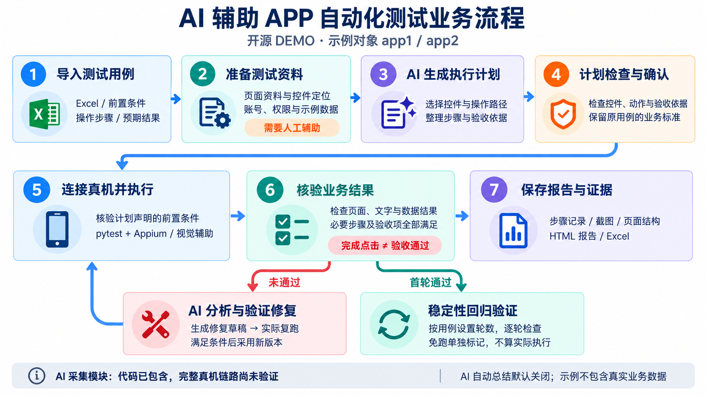

# AI Test Automation Platform

基于 FastAPI、pytest 与 Appium 的移动端自动化测试 DEMO，支持 AI 辅助生成执行计划、计划审核、真机执行、结果验收、失败分析与稳定性回归。

本项目采用 [MIT License](LICENSE) 开源。

## 业务流程



## 快速启动网页 DEMO

需要 Python 3.11 或以上。网页演示可以在没有手机、Appium 或 AI 密钥的环境中启动。

Windows / PowerShell：

```powershell
python -m venv .venv
.\.venv\Scripts\python.exe -m pip install -r requirements.txt
.\scripts\start.ps1 -UiOnly
```

打开 http://127.0.0.1:8000 。首次启动会在 `runtime-data/` 中建立空数据库；不会加载任何历史用例或执行记录。也可以直接启动：

```powershell
.\.venv\Scripts\python.exe -m uvicorn app.main:app --host 127.0.0.1 --port 8000
```

macOS / Linux：

```bash
python3 -m venv .venv
.venv/bin/python -m pip install -r requirements.txt
.venv/bin/python -m uvicorn app.main:app --host 127.0.0.1 --port 8000
```

## 全新虚构用例

运行下面的命令，生成包含 `app1`、`app2` 两条虚构用例的 Excel，再从网页导入。示例只用于体验用例管理，不能视为已通过的真机测试。

```powershell
.\.venv\Scripts\python.exe scripts/create_demo_cases.py
```

输出为 `runtime-data/demo-cases.xlsx`。所有文字均为新建示例，不包含真实业务数据。

## 真机执行

安装 Node.js、Android Platform Tools、Appium 和 UiAutomator2，手机启用 USB 调试并授权：

```powershell
npm install -g appium
appium driver install uiautomator2
$env:ADB_PATH = "你的Android SDK\platform-tools\adb.exe"
$env:ANDROID_APP_PACKAGE = "你的被测App包名"
$env:ANDROID_APP_ACTIVITY = "你的被测App启动Activity"
$env:ANDROID_DEVICE_UDID = "你的设备编号"
$env:ANDROID_DEVICE_NAME = "你的设备名称"
.\scripts\start.ps1
```

示例名称统一为 `app1`、`app2`；`com.example.app1`、`com.example.app2` 及 `example_element_*` 都是虚构占位符。原 App 的内置定位表、导航资料与历史页面证据已移除。真机测试需要自己配置实际包名、Activity 和定位资料，核验后再确认计划。

自有定位表可放在本机 `runtime-data/locator_catalog.json`，结构为：

```json
{
  "app_package": "com.example.app1",
  "navigation_routes": [],
  "post_tap_page_markers": {},
  "targets": {
    "example.home": {
      "description": "app1 示例首页控件，需替换为已核验的定位",
      "android_locators": [
        {"strategy": "resource_id", "value": "com.example.app1:id/example_element_001"}
      ]
    }
  }
}
```

## 配置 AI

进入“模型配置”，分别设置文本解析与视觉模型的 OpenAI 兼容接口地址、API Key 和模型名称。视觉模型需支持图片输入。配置保存于本机运行目录，禁止提交到 GitHub。没有配置模型时，网页仍可启动，但 AI 功能需要完成配置后才能使用。

计划采用 JSON，pytest 启动固定执行入口，Python 执行器读取动作并调用 Appium。AI 生成的计划需要核对动作、前置条件与验收依据；完成点击不代表业务结果通过。

## 公开版范围与验证限制

- 公开版不包含原 App 名称、包名、定位表、运行数据库、真实用例、业务截图、实际通过数量、设备编号或模型密钥。
- 流程图为重新生成的说明图，示例用例为全新虚构数据；它们不是运行证据。
- 公开 Git 历史从脱敏后的首次提交开始。
- 已验证全新虚拟环境安装、空数据库网页启动、7 个基础页面、虚构用例导入和待审核草稿生成；真机、AI 调用和稳定性完整链路需要使用者自行配置并验证。
- AI 采集模块代码已包含，完整真机链路尚未验证；AI 自动总结默认关闭。
- DEMO 没有身份认证，默认仅监听本机地址。

## 本机数据

`.gitignore` 排除虚拟环境、运行目录、数据库、日志、环境变量文件、模型配置与执行证据。新增用例或素材时也需要确认没有真实业务数据，再决定是否上传。
